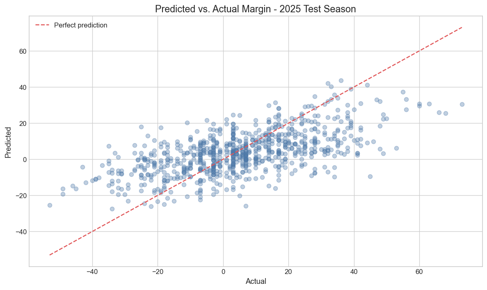
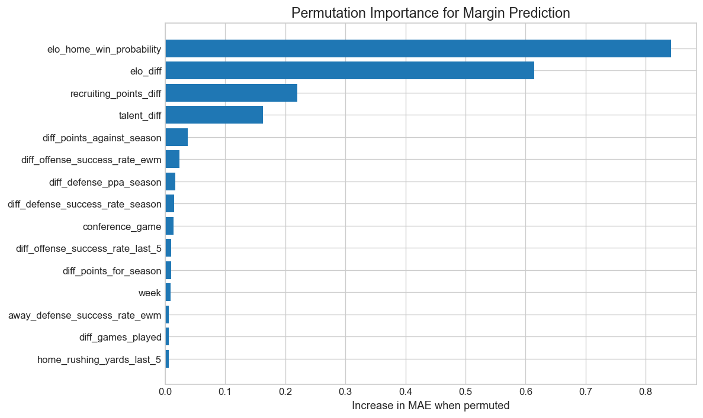

# Predicting College Football Scores with Machine Learning

Alexander Parks

## Introduction and Motivation

College football provides an interesting prediction problem because teams play relatively few games, the quality of opponents varies significantly, and each roster changes between seasons. Final scores are also affected by turnovers, special teams, overtime, and a small number of high-impact plays. Thus, a model must determine which portions of a team's prior performance are useful for predicting future games.

The purpose of this project was to construct a model that predicts final scores for games between two FBS teams. I also wanted the model to be useful throughout the season. After the historical analysis is complete, the final notebook can be run once per week to incorporate the previous week's results and predict the upcoming schedule.

The project aims to answer three central questions:

1. How accurately can final scores be predicted using only information available before kickoff?
2. Which model family performs best when it is evaluated on future seasons?
3. How does the model compare to the betting market, and does combining the two improve the predictions?

## Data

The data was collected from the CollegeFootballData API. The final dataset contains completed FBS-vs-FBS games beginning in 2014. We collected game results, team box scores, advanced game statistics, talent, recruiting, and historical betting lines.

The raw API data was transformed into two main tables. First, we created a team-game table where each completed game appears twice: once from the home team's perspective and once from the away team's perspective. Next, we created a modeling table where each record represents one game. The modeling table contains 161 statistics-only features.

For each team statistic, we considered three summaries:

- Average over the five most recent games
- Exponentially weighted average, which gives more weight to recent games
- Average over the current season

The features include scoring, yardage, pace, turnovers, third- and fourth-down performance, EPA, success rate, explosiveness, Elo, recruiting, talent, and rest. Difference features were calculated by subtracting the away team's value from the home team's value.

## Preventing Data Leakage

Preventing leakage was one of the most important parts of constructing the dataset. A game in Week 8 cannot use any statistics calculated from that game or a later game. Each team snapshot was therefore joined to a target game only if the snapshot's date was strictly earlier than kickoff.

We also kept betting information out of the original model. The spread and over/under remained in the dataset for the later comparison, but an automated check confirmed that neither was included in the model's feature list. Imputation and scaling were performed inside each model pipeline so future seasons did not influence transformations fitted on prior seasons.

## Prediction Targets

We predicted margin and total points rather than predicting the two team scores independently:

`margin = home score - away score`

`total = home score + away score`

The two final scores can then be reconstructed from the predicted margin and total. This approach is helpful because margin represents the difference in team strength, while total represents the expected scoring environment.

## Model Selection

We compared Ridge Regression, Elastic Net, Random Forest, Histogram Gradient Boosting, RBF Support Vector Regression, and a multi-layer neural network. These models represent regularized linear relationships, bagging, boosting, a nonlinear kernel, and deep learning. The neural network used ReLU hidden layers, dropout, AdamW, weight decay, Huber loss, and early stopping.

Each family completed the same modeling lifecycle. Imputation and scaling were included inside the model pipelines, and hyperparameters were selected with expanding-season validation from 2020 through 2023. The bounded search evaluated 52 settings for each target across four folds.

We also constructed a stacking ensemble. Each base-model input to the stacker was an out-of-fold prediction from a model that had not seen the corresponding season. A nonnegative linear regression learned the ensemble weights. This provided an interpretable combination and avoided training the stacker on fitted predictions.

The 2024 season was reserved for a later selection between the six individual models and the ensemble. Random Forest produced the lowest 2024 margin MAE at 12.92 points. The stacking ensemble produced the lowest total MAE at 12.782 points, narrowly improving on Gradient Boosting at 12.785. Therefore, Random Forest was selected for margin and the ensemble was selected for total. These decisions were locked before the 2025 targets were evaluated.

In the earlier tuning folds, Gradient Boosting produced the lowest margin MAE at 13.10 points, while Elastic Net produced the lowest total MAE at 13.08. The neural network was competitive but did not win: its validation MAE was 13.26 for margin and 13.12 for total. This result supports testing multiple model families rather than assuming that the most complex model will perform best on tabular data.

## Results

The final results are shown below.

| Metric | Statistics-only model | Market | Hybrid |
| --- | ---: | ---: | ---: |
| Margin MAE | 12.55 | 11.82 | 11.82 |
| Margin RMSE | 15.98 | 15.01 | 14.99 |
| Total MAE | 12.65 | 12.54 | 12.62 |
| Total RMSE | 15.65 | 15.55 | 15.58 |
| Home score MAE | 9.40 | 9.05 | 9.15 |
| Away score MAE | 8.51 | 8.14 | 8.15 |
| Winner accuracy | 72.9% | 73.6% | 73.6% |

The statistics-only system predicted the correct winner in 72.9% of the test games. Its average margin error was 12.55 points, and its average total error was 12.65 points.

The 2025 family comparison was reported for transparency rather than used for another selection decision. The ensemble obtained the lowest test margin MAE at 12.546, followed closely by the selected Random Forest at 12.547. For total, the neural network obtained the lowest descriptive test MAE at 12.590, while the selected ensemble obtained 12.651. Switching models after seeing these results would make the test season another validation set, so the locked 2024 choices remain the reported system.

The market was stronger at predicting margin. Its margin MAE was 0.72 points lower than that of the statistics-only model. A paired bootstrap produced a 95% interval from 0.37 to 1.06 points for this difference, so the advantage was relatively stable across the test games.

The difference for total points was much smaller. The market improved MAE by approximately 0.11 points, but the bootstrap interval ranged from approximately -0.12 to 0.34. Because this interval contains zero, the test does not provide strong evidence that either method was a better total-points predictor in 2025.

The hybrid model used linear regression to combine the statistical and market predictions. It did not improve on the market: its margin MAE was nearly identical, while its total MAE was slightly worse. This suggests that the statistics-only model did not add enough independent information to improve a simple market combination.

The nominal 90% prediction intervals covered 89.4% of final margins and 89.2% of final totals. Thus, the observed coverage was close to the intended level, although the intervals were wide because college football scores are difficult to predict precisely.

## Model Interpretation

The most important feature for margin prediction was the pregame win probability derived from Elo. Elo difference, recruiting difference, and talent difference were also among the most important features. Measures of prior points allowed and offensive and defensive success rate provided additional value.

These results are reasonable. Elo summarizes opponent-adjusted results over time, while recruiting and talent provide useful information when a current-season sample is still small. Success rate measures whether an offense or defense performs consistently rather than relying only on final score or a few explosive plays.

## Weekly Predictions

The final notebook refreshes the current season, adds completed games to each team's history, and retrains all six base models with fixed hyperparameters. It then applies the saved stacking weights and selected primary systems to the next scheduled week. Each output is saved with its generation time so it can be evaluated after the games are complete without replacing the original prediction.

Statistics-only predictions are produced for every upcoming FBS matchup. Market and hybrid predictions are added only when betting lines are available.

## Conclusion

This project demonstrates that public historical and advanced football data can produce meaningful final-score predictions. The statistics-only system correctly predicted nearly 73% of winners in the untouched test season, and its total-points accuracy was similar to the betting market. The additional models also produced an important negative result: the neural network was competitive, but it did not consistently outperform regularized regression or tree methods on this structured dataset.

However, the market remained a stronger predictor of score margin, and the hybrid model did not improve upon it. These findings are not a failure of the project. Sportsbooks combine public data with injuries, team news, expert information, and market behavior. Comparing against this benchmark provides a more realistic evaluation than comparing only against simple machine learning baselines.

There are several possible extensions. Injury and player availability data could improve individual weekly predictions if a reliable free source becomes available. It may also be useful to estimate team strength with a hierarchical model or to construct opponent-adjusted efficiency features directly from play-level data. Lastly, the archived weekly predictions will provide a growing real-time evaluation that is separate from historical backtesting.

## References

CollegeFootballData. (2026). [College Football Data API](https://api.collegefootballdata.com/getting-started).

Gilani, S., Easwaran, A., Lee, J., and Hess, E. (2026). [cfbfastR: Access College Football Play by Play Data](https://github.com/sportsdataverse/cfbfastR).

South, C. and Egros, E. (2020). [Forecasting college football game outcomes using modern modeling techniques](https://journals.sagepub.com/doi/10.3233/JSA-190314).
